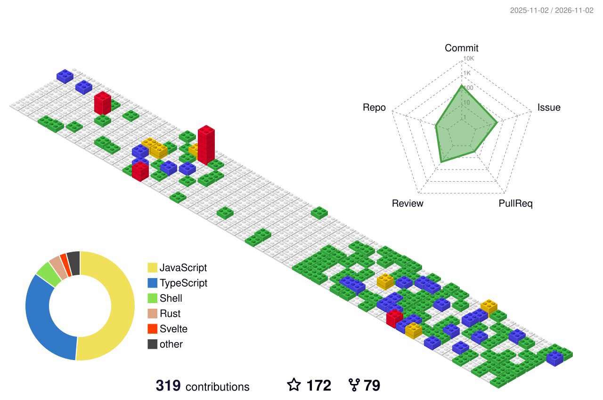

# Hi, I'm Claude Barde 👋

Developer Relations Engineer and front-end developer based in Toulouse, France.

## About me

I'm a self-taught developer with a background in linguistics, and I've spent the last five years helping developers get productive with blockchain technologies. I got into DevRel by contributing open source to Taquito and the wider Tezos ecosystem as a community developer, until the Taquito team offered me a full-time role.

Since then I've written documentation, built sample apps and developer tooling, produced tutorials and videos, and represented protocols at hackathons and conferences.

### Where I've worked

- **Midnight Foundation** (2024 - 2026), Developer Relations Engineer: technical docs and TypeScript sample apps to onboard developers on a zero-knowledge stack, including a mempool visualizer fed by real-time WebSocket data and tested examples for wallet SDKs, native tokens and privacy-preserving apps.
- **TriliTech** (2023 - 2024), Developer Relations Engineer for Tezos: articles, blog posts and videos, JS/TS demos integrating Tezos APIs, wallets and smart contracts, and representation at 2 international hackathons and 5 developer conferences.
- **Ecad Labs** (2020 - 2023), Developer Relations Engineer for Taquito: supported dozens of developers, wrote 50+ pages of documentation and built template dapps.
- **Freelance translator** (2016 - 2020): 2,000+ wikiHow articles and 1,000+ Amazon product descriptions, English to French.

### What I'm doing now

Since March 2026 I work on independent projects:

- [modernsumerian.org](https://modernsumerian.org): my website about the Sumerian language, where I publish content and tools such as a conjugator, a dictionary and a keyboard for ancient Sumerian.
- [Sumer Travel Phrasebook](https://modernsumerian.gumroad.com/l/sumer-travel-phrasebook): a phrasebook for travelling in ancient Sumer, available on Gumroad.
- [sumer-farming](https://github.com/claudebarde/sumer-farming): a browser-based farming game set in ancient Sumer, built with React, TypeScript, Vite and Cloudflare Workers.

## Tech stack

Web3: Taquito, Viem, Wagmi, ethers.js, Hardhat, Foundry, Compact, Michelson, Huff. I also know my way around consensus algorithms and cryptography.

Languages: French (native), English and Romanian (fluent), German (working knowledge), Spanish (basic).

## Things I've written and recorded

- 🎤 [How to build dApps on Tezos using Taquito](https://youtu.be/V132Is3-Htg) (talk)
- 🎥 [Midnight for Developers: Advanced Concepts of Compact](https://youtu.be/F0bSl1AO_iw)
- 🎥 [Dev Success | Interacting with FA2 Contracts Using Taquito](https://youtu.be/xL6jyW1sqmA)
- ✍️ [Written tutorials on Medium](https://claudebarde.medium.com/)

## Get in touch

[LinkedIn](https://linkedin.com/in/claudebarde) · [X / Twitter](https://x.com/claudebarde)
